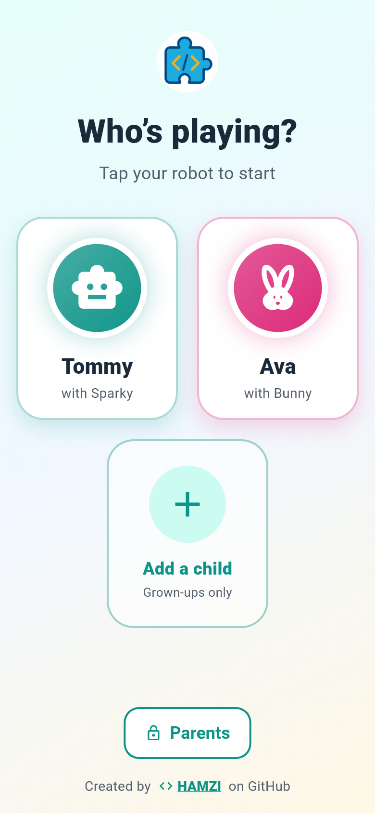
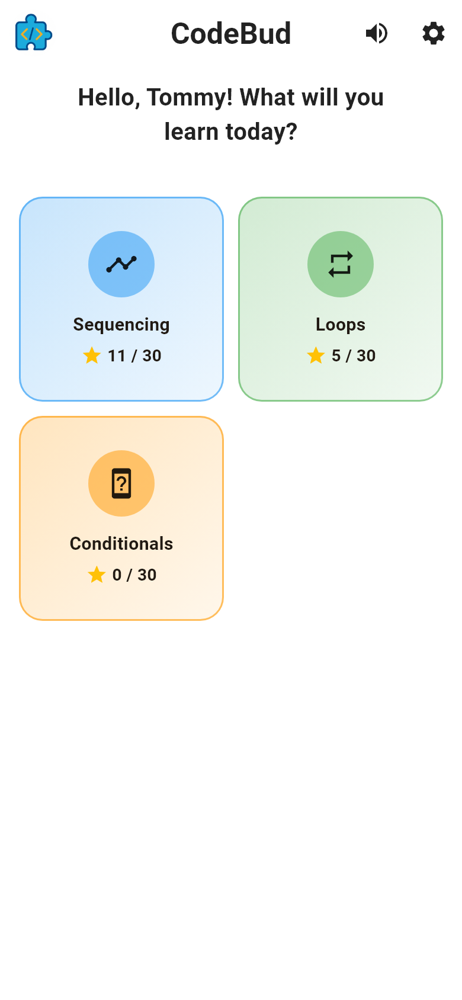
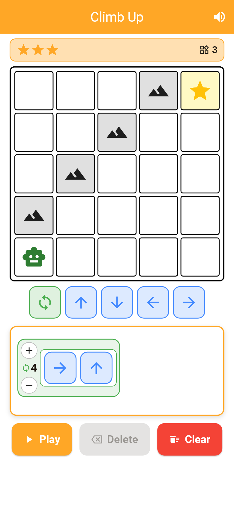
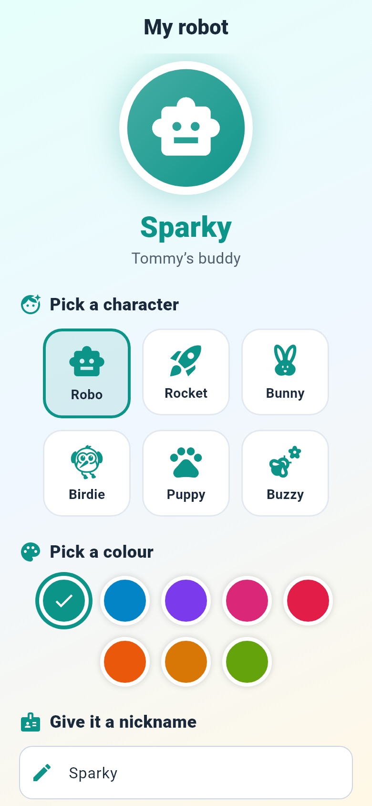
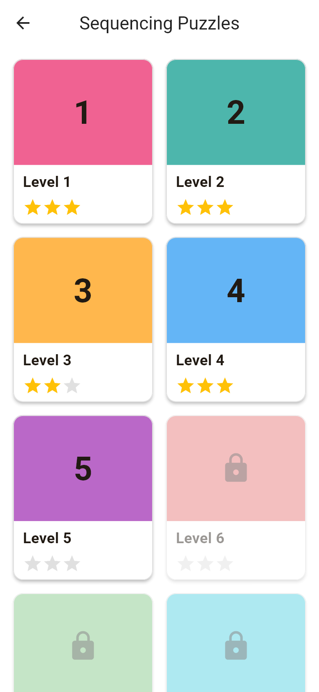
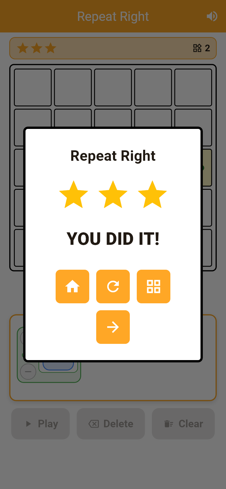
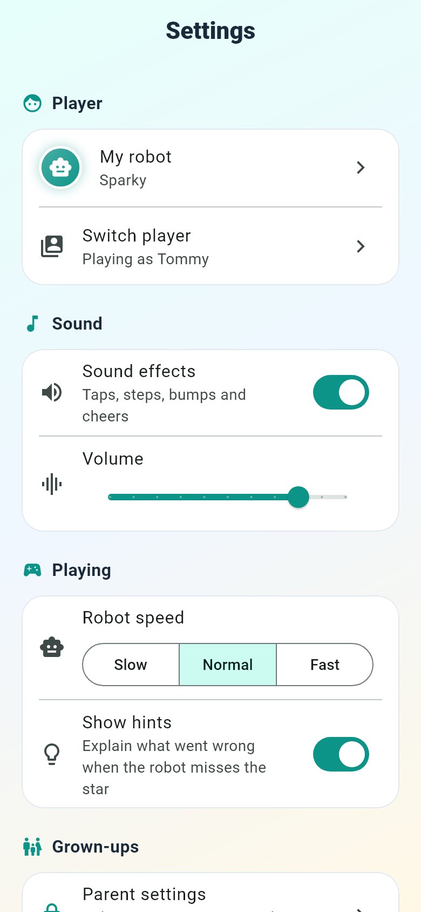

# CodeBud: a visual coding adventure for kids

CodeBud teaches children aged 4–7 the basics of programming (**sequencing, loops and if-then logic**) through picture-block puzzles. Kids drag arrow, loop and if blocks into a program, press play, and watch their own robot buddy try to reach the star. Children don't need to read anything. Everything is icons, colour, animation and sound.

One family account holds several children. Each child picks their profile on a "Who's playing?" screen, customises their robot, and earns their own stars, while account settings stay locked behind the parent's password.

**Stack:** a Flutter app (web, iOS, macOS, Windows, Linux), a Flask API, and MongoDB.


| Who's playing? | Home | Puzzle | My robot |
|---|---|---|---|
|  |  |  |  |

| Levels | Success | Settings |
|---|---|---|
|  |  |  |

## Features

- **30 levels in three categories:** Sequencing, Loops and Conditionals. Levels unlock one at a time.
- **Conditionals where the rocks move:** most Conditionals levels have 2–3 boards with the rocks (or the star) in different places, and one program has to solve them all. No fixed list of arrows can, so children learn to make the robot *look before it moves*. A hint suggests an If block when a program only works on some boards.
- **Drag-and-drop or tap-to-add blocks**, with loops (repeat 2–10 times) and if-blocks that read as a picture: 👁 a direction, then what to look for (a rock, an empty cell or the star).
- **Family accounts:** sign up once with 1–6 children. A **"Who's playing?"** screen lets each child pick their profile, and stars and unlocked levels are kept separately for each child.
- **Robot buddies:** each child picks a character (robot, rocket, bunny, bird, puppy or bee), a colour and a nickname. Their buddy appears on the board, the home screen and the win celebration.
- **Parent lock:** account settings need the parent's password. The server issues a short-lived parent token, and every parent-only request is checked against it, so a child can't get round the lock. Parents can add, rename and remove children, reset each child's progress, update their details, change the password and log out.
- **Stars for short programs:** finishing always earns at least one star, and hints explain what went wrong.
- **Sound effects** for every tap, step and bump, plus a celebration with claps and star chimes.
- **Bright, gender-neutral design:** a teal theme with sunny yellow, sky blue and violet accents.
- **Landing page** with a playable demo of each concept, so visitors can try it without an account.
- **Kids' settings:** sound, volume, robot speed, hints, "My robot" and "Switch player".

## Quick start

You need Python 3.10+, Flutter 3.32 and MongoDB. Docker is the quickest way to get MongoDB.

```bash
# 1. Database
docker run -d --name codebud-mongo -p 27017:27017 mongo:7

# 2. API  →  http://127.0.0.1:5000
cd backend
python -m venv .venv && source .venv/bin/activate   # Windows: .venv\Scripts\Activate.ps1
pip install -r requirements-dev.txt
cp .env.example .env                                 # has CODEBUD_ENV=development and a local MONGO_URI
python ../database/seed.py                           # load the 30 puzzles (re-run after levels change)
python app.py

# 3. App (in a second terminal)
cd frontend/flutter_app
flutter pub get
flutter run -d chrome --dart-define=API_BASE_URL=http://127.0.0.1:5000
```

**[docs/LOCAL_DEVELOPMENT.md](docs/LOCAL_DEVELOPMENT.md)** has the full guide: Atlas or a local MongoDB instead of Docker, VS Code launch configs, running the tests, common tasks and troubleshooting.

## Deployment

The database runs on MongoDB Atlas, the API on Render, and the web app on Firebase Hosting. After checks pass on `main`, GitHub Actions deploys automatically.

**[docs/DEPLOYMENT.md](docs/DEPLOYMENT.md)** walks through each service, the required secrets, releasing, rolling back, and a checklist for a fresh deployment.

> The deploy workflows are currently **disabled**. The guide explains how to turn them back on.

## Project structure

```
backend/                      Flask API
  app.py                      entry point (gunicorn app:app)
  codebud/                    create_app() factory, config, db, validation
    engine.py                 the game rules (mirrors engine.dart), including multi-board puzzles
    family.py                 child profiles, robots, the parent token, old-account conversion
    routes/                   auth and children, puzzles and progress endpoints
  tests/                      pytest (in-memory MongoDB via mongomock)
database/
  build_puzzles.py            level definitions as ASCII maps, each checked against a reference solution
  puzzles.json                generated by build_puzzles.py
  seed.py                     upserts puzzles into MongoDB and creates indexes
frontend/flutter_app/
  lib/
    game/engine.dart          the game rules: runs a program, returns the path and stars
    models/family.dart        children, robot characters and colours
    services/                 ApiClient, Auth (family session, parent lock)/Puzzle/Sound services, settings
    screens/                  landing, auth, who's playing, home, robot studio, levels, puzzle, settings
    widgets/                  board, blocks, playground, robot avatar, parent lock, popups
    data/demo_puzzles.dart    levels bundled for the landing-page demo
  assets/sounds/              sound effects (generated by tool/generate_sounds.py)
  assets/screenshots/         screenshots (generated by test_screenshots/)
  test/                       unit and widget tests, with a fake backend
docs/                         local development, deployment, product notes
.github/workflows/            CI and deploys for the backend and frontend
```

## How it works

**One set of game rules, implemented twice.** `engine.dart` runs programs on the device, so the robot animates with no network delay. `engine.py` runs the same rules on the server. When a child solves a level, the app sends the **program** rather than a star count. The server replays it and decides the stars, so they can't be faked. Tests on both sides run every level's reference solution, so the two engines can't drift apart.

| Block | Meaning |
|---|---|
| ⬆️ ⬇️ ⬅️ ➡️ | Move one cell. Hitting the edge or a rock ends the run with a hint. |
| 🔁 Loop | Repeat the blocks inside 2–10 times. A loop can contain moves and if-blocks. |
| 🔀 If | Run the blocks inside only when the neighbouring cell in a direction is a rock (the edge counts), empty, or the star. |

The run ends as soon as the robot reaches the star. A level can have several boards (`variants` in `puzzles.json`). The program runs on each board in turn and has to reach the star on all of them. **Stars:** every block counts, nested ones too. At or under the level's *par* earns ⭐⭐⭐, up to par + 2 earns ⭐⭐, and any other solution earns ⭐.

**Content as code.** Levels are drawn as text maps in `database/build_puzzles.py`. The build fails if a level can't be solved, if its reference solution doesn't reach the star on every board, or if plain moves alone can solve every board of a multi-board level (so the If block is always needed there). CI checks that `puzzles.json` is up to date.

**Families and the parent lock.** A user document holds the parent's details and a `children` list. Progress rows carry a `child_id`. Logging in gives a 7-day account token, which is enough to play and to change your own robot. Parent-only actions need a 30-minute *parent token* from `POST /api/parent/unlock`, which checks the password again. The app keeps that token in memory only and drops it when the parent leaves parent settings. Accounts created before families existed are converted the first time they're loaded.

**Generated assets.** The sound effects are synthesized by a script, so there's nothing to license. The screenshots are rendered from the real screens by `test_screenshots/` (`flutter test test_screenshots --update-goldens`).

## API

| Method | Path | Auth | Purpose |
|---|---|---|---|
**Auth:** *JWT* is the account token from `/login`. *Parent* is the short-lived token from `/api/parent/unlock`.

| Method | Path | Auth | Purpose |
|---|---|---|---|
| POST | `/signup` | – | Create a family account with `children: [{name, age}, ...]` (1–6) |
| POST | `/login` | – | Returns a JWT valid for 7 days, and the children |
| POST | `/api/parent/unlock` | JWT | Check the password again and get a parent token (30 minutes) |
| GET | `/api/me` | JWT | The parent's details and the children |
| PATCH | `/api/me` | Parent | Update the parent's name and email |
| POST | `/api/me/password` | Parent | Change password (requires the current one) |
| GET / POST | `/api/children` | JWT / Parent | List the children / add a child |
| PATCH | `/api/children/<id>` | JWT or Parent | Change the robot (JWT); change name or age (Parent) |
| DELETE | `/api/children/<id>` | Parent | Remove a child and their progress (the last child can't be removed) |
| GET | `/api/puzzles/<category>` | JWT | Levels in a category, with the child's best stars (`?child_id=`) |
| GET | `/api/puzzle/<id>` | – | One level, its extra boards, and a link to the next (the solution is never sent) |
| POST | `/api/validate_sequence` | – | Run a program on every board and get the result and a hint |
| GET / POST | `/api/progress` | JWT | A child's per-category totals / save a solved program (`child_id`) |
| DELETE | `/api/progress` | Parent | Reset a child's progress (`?child_id=`, and `&category=` for one category) |
| GET | `/health` | – | Health check |

Requests without a `child_id` use the first child, so older clients keep working.

## Testing

```bash
cd backend && pytest                                  # API, engine, and puzzle content
cd frontend/flutter_app && flutter analyze && flutter test   # engine, widgets, families, landing page, settings
```

CI runs these checks, plus a format check, on every pull request.

## More

- [Product notes](docs/PRODUCT.md): vision, personas, user stories, design guidelines
- [Prototype in Visily](https://app.visily.ai/projects/44b88f73-7690-4228-86c4-96b70062a295/boards/1927196)

---

Created by [HAMZl](https://github.com/HAMZl).
