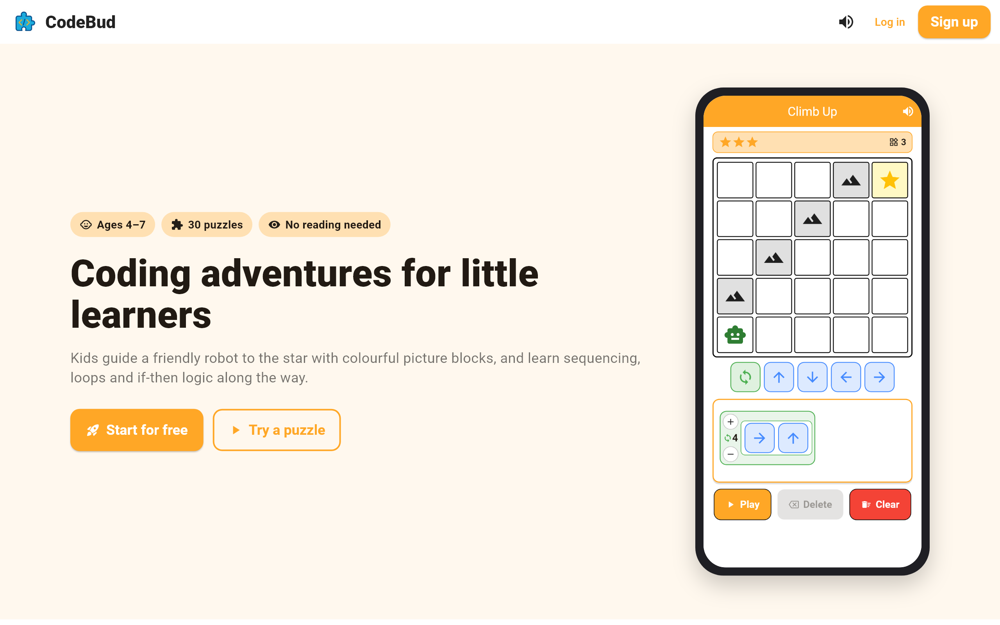

# CodeBud: a visual coding adventure for kids

CodeBud teaches children aged 4–7 the basics of programming (**sequencing, loops and if-then logic**) through picture-block puzzles. Kids drag arrow, loop and if blocks into a program, press play, and watch a friendly robot try to reach the star. Children don't need to read anything. Everything is icons, colour, animation and sound.

**Stack:** a Flutter app (web, iOS, macOS, Windows, Linux), a Flask API, and MongoDB.



| Home | Levels | Puzzle | Success | Settings |
|---|---|---|---|---|
|  |  |  |  |  |

## Features

- **30 levels in three categories:** Sequencing, Loops and Conditionals. Levels unlock one at a time.
- **Drag-and-drop or tap-to-add blocks**, with loops (repeat 2–10 times) and if-blocks (look for a rock, an empty cell or the star in any direction).
- **Stars for short programs:** finishing always earns at least one star, and hints explain what went wrong.
- **Sound effects** for every tap, step and bump, plus a celebration with claps and star chimes.
- **Landing page** with a playable demo, so visitors can try it without an account.
- **Settings:** sound, volume, robot speed and hints. A **parent area** behind a grown-ups-only check covers the profile, progress reset, password and log out.

## Quick start

You need Python 3.10+, Flutter 3.32 and MongoDB. Docker is the quickest way to get MongoDB.

```bash
# 1. Database
docker run -d --name codebud-mongo -p 27017:27017 mongo:7

# 2. API  →  http://127.0.0.1:5000
cd backend
python -m venv .venv && source .venv/bin/activate   # Windows: .venv\Scripts\Activate.ps1
pip install -r requirements-dev.txt
cp .env.example .env                                 # has CODEBUD_ENV=development and a local MONGO_URI
python ../database/seed.py                           # load the 30 puzzles
python app.py

# 3. App (in a second terminal)
cd frontend/flutter_app
flutter pub get
flutter run -d chrome --dart-define=API_BASE_URL=http://127.0.0.1:5000
```

**[docs/LOCAL_DEVELOPMENT.md](docs/LOCAL_DEVELOPMENT.md)** has the full guide: Atlas or a local MongoDB instead of Docker, VS Code launch configs, running the tests, common tasks and troubleshooting.

## Deployment

The database runs on MongoDB Atlas, the API on Render, and the web app on Firebase Hosting. After checks pass on `main`, GitHub Actions deploys automatically.

**[docs/DEPLOYMENT.md](docs/DEPLOYMENT.md)** walks through each service, the required secrets, releasing, rolling back, and a checklist for a fresh deployment.

> The deploy workflows are currently **disabled**. The guide explains how to turn them back on.

## Project structure

```
backend/                      Flask API
  app.py                      entry point (gunicorn app:app)
  codebud/                    create_app() factory, config, db, validation
    engine.py                 the game rules (mirrors engine.dart)
    routes/                   auth, puzzles and progress endpoints
  tests/                      pytest (in-memory MongoDB via mongomock)
database/
  build_puzzles.py            level definitions as ASCII maps, each checked against a reference solution
  puzzles.json                generated by build_puzzles.py
  seed.py                     upserts puzzles into MongoDB and creates indexes
frontend/flutter_app/
  lib/
    game/engine.dart          the game rules: runs a program, returns the path and stars
    services/                 ApiClient, Auth/Puzzle/Sound services, settings, AppScope
    screens/                  landing, auth, home, levels, puzzle, settings
    widgets/                  board, blocks, playground, popups
    data/demo_puzzles.dart    levels bundled for the landing-page demo
  assets/sounds/              sound effects (generated by tool/generate_sounds.py)
  assets/screenshots/         screenshots (generated by test_screenshots/)
  test/                       unit and widget tests, with a fake backend
docs/                         local development, deployment, product notes
.github/workflows/            CI and deploys for the backend and frontend
```

## How it works

**One set of game rules, implemented twice.** `engine.dart` runs programs on the device, so the robot animates with no network delay. `engine.py` runs the same rules on the server. When a child solves a level, the app sends the **program** rather than a star count. The server replays it and decides the stars, so they can't be faked. Tests on both sides run every level's reference solution, so the two engines can't drift apart.

| Block | Meaning |
|---|---|
| ⬆️ ⬇️ ⬅️ ➡️ | Move one cell. Hitting the edge or a rock ends the run with a hint. |
| 🔁 Loop | Repeat the blocks inside 2–10 times. A loop can contain moves and if-blocks. |
| ❓ If | Run the blocks inside only when the neighbouring cell in a direction is a rock (the edge counts), empty, or the star. |

The run ends as soon as the robot reaches the star. **Stars:** every block counts, nested ones too. At or under the level's *par* earns ⭐⭐⭐, up to par + 2 earns ⭐⭐, and any other solution earns ⭐.

**Content as code.** Levels are drawn as text maps in `database/build_puzzles.py`. The build fails if a level can't be solved or its reference solution doesn't reach the star, and CI checks that `puzzles.json` is up to date.

**Generated assets.** The sound effects are synthesized by a script, so there's nothing to license. The screenshots are rendered from the real screens by `test_screenshots/` (`flutter test test_screenshots --update-goldens`).

## API

| Method | Path | Auth | Purpose |
|---|---|---|---|
| POST | `/signup` | – | Create a parent and child account |
| POST | `/login` | – | Returns a JWT, valid for 7 days |
| GET / PATCH | `/api/me` | JWT | Read or update the child and parent profile |
| POST | `/api/me/password` | JWT | Change password (requires the current one) |
| GET | `/api/puzzles/<category>` | JWT | Levels in a category, with best stars |
| GET | `/api/puzzle/<id>` | – | One level and a link to the next (the solution is never sent) |
| POST | `/api/validate_sequence` | – | Run a program and get the result and a hint |
| GET / POST / DELETE | `/api/progress` | JWT | Per-category totals / save a solved program / reset (`?category=` for one category) |
| GET | `/health` | – | Health check |

## Testing

```bash
cd backend && pytest                                  # API, engine, and puzzle content
cd frontend/flutter_app && flutter analyze && flutter test   # engine, widgets, landing page, settings
```

CI runs these checks, plus a format check, on every pull request.

## More

- [Product notes](docs/PRODUCT.md): vision, personas, user stories, design guidelines
- [Prototype in Visily](https://app.visily.ai/projects/44b88f73-7690-4228-86c4-96b70062a295/boards/1927196)
